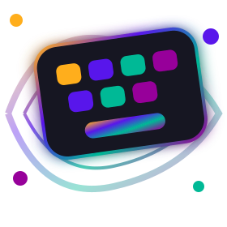
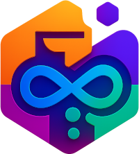

<div align="center">



# Keyboard Simulator

<a href="LICENSE"></a>
<a href="https://nextjs.org/"></a>
<a href="https://reactjs.org/"></a>
<a href="https://www.typescriptlang.org/"></a>
<a href="https://tailwindcss.com/"></a>

**Official landing page for Keyboard Simulator — a cross-platform keyboard simulation and visualization application by Roboticela.**

[About](#-about) • [Technology Stack](#-technology-stack) • [Installation](#-installation) • [Running & Building](#-running--building) • [License](#-license)

---

</div>

## 📖 Table of Contents

- [About](#-about)
- [Technology Stack](#-technology-stack)
- [Prerequisites](#-prerequisites)
- [Installation](#-installation)
- [Running & Building](#-running--building)
- [Icons Generation](#-icons-generation)
- [Project Structure](#-project-structure)
- [Support](#-support)
- [License](#-license)
- [About Roboticela](#-about-roboticela)

---

## 🌟 About

This repository contains the **official landing page** for [Keyboard Simulator](https://keyboard-simulator.roboticela.com) — the marketing and information website for the Keyboard Simulator product.

Keyboard Simulator is a cross-platform application for realistic keyboard simulation and visualization. This frontend project does not include the desktop or mobile app itself; it serves the public website that introduces the product, links to downloads and resources, and presents key information to visitors.

The landing page links to the **web app** at [app.keyboard-simulator.roboticela.com](https://app.keyboard-simulator.roboticela.com) for the live 3D simulator and to [app.keyboard-simulator.roboticela.com/games](https://app.keyboard-simulator.roboticela.com/games) for **20 keyboard games** — each focused on a single skill (typing speed, accuracy, shortcuts, layouts, reaction time, and more).

The landing page is built with **Next.js**, **React**, and **TypeScript**, styled with **Tailwind CSS**, and configured through [Roboticela DevKit](https://github.com/Roboticela/DevKit).

---

## 🛠️ Technology Stack

| Layer     | Technology |
|-----------|------------|
| Framework | [Next.js 16](https://nextjs.org/), [React 19](https://reactjs.org/), [TypeScript 5.x](https://www.typescriptlang.org/) |
| Styling   | [Tailwind CSS 4](https://tailwindcss.com/), [PostCSS](https://postcss.org/) |
| Tooling   | ESLint, npm, [Roboticela DevKit](https://github.com/Roboticela/DevKit) |
| Assets    | [sharp](https://sharp.pixelplumbing.com/), [to-ico](https://www.npmjs.com/package/to-ico) (icon generation) |

---

## 📋 Prerequisites

- **Node.js** v20 or later — [Download](https://nodejs.org/)
- **npm** — included with Node.js

---

## 📥 Installation

```bash
git clone git@github.com:Roboticela/Keyboard-Simulator-Frontend.git
cd Keyboard-Simulator-Frontend
npm install
```

---

## 🚀 Running & Building

### Development

```bash
npm run dev
```

Open [http://localhost:3000](http://localhost:3000) in your browser.

### Production build

```bash
npm run build
npm run start
```

### Lint

```bash
npm run lint
```

### IndexNow (search engine URL submission)

```bash
npm run indexnow:submit
```

Requires `INDEXNOW_KEY` and `INDEXNOW_SUBMIT_SECRET` — see `.env.example`.

---

## 🎨 Icons Generation

Icons are generated from a single source image (default: `public/favicon.svg`).

```bash
npm run icons:generate
```

Or with a custom source path:

```bash
npm run icons:generate -- public/logo.svg
```

This writes web icons to `public/`:

- `favicon-16x16.png`
- `favicon-32x32.png`
- `apple-touch-icon.png`
- `favicon.ico` (when `to-ico` is installed)

---

## 📁 Project Structure

```
Keyboard-Simulator-Frontend/
├── app/
│   ├── layout.tsx          # Root layout, metadata, theme script
│   ├── page.tsx            # Landing page (metadata + HomePage)
│   ├── blogs/              # Blog index and article routes
│   ├── sitemap.ts          # Sitemap generation
│   ├── robots.ts           # Robots.txt
│   └── globals.css         # Global styles and themes
├── components/
│   ├── HomePage.tsx        # Landing page sections
│   ├── Hero.tsx            # Hero with simulator & games CTAs
│   ├── Games.tsx           # 20 single-purpose game cards (links to web app)
│   ├── Navbar.tsx, Footer.tsx
│   └── blogs/              # Blog list and article UI
├── lib/
│   ├── constants.ts        # SITE_URL, APP_URL, GAMES_URL, etc.
│   ├── games/              # Game titles, slugs, and external URLs
│   ├── blogs/              # Blog content and helpers
│   └── seo/                # SEO metadata helpers
├── public/
│   └── favicon.svg         # Default icon source
├── scripts/
│   ├── icons-generate.js   # Web icon generation
│   └── submit-indexnow.mjs # IndexNow submission
├── devkit.config.json      # DevKit site and theme config
├── next.config.ts
├── package.json
├── LICENSE
└── README.md
```

### External links (configured in `lib/constants.ts`)

| Constant   | URL |
|------------|-----|
| `SITE_URL` | https://keyboard-simulator.roboticela.com |
| `APP_URL`  | https://app.keyboard-simulator.roboticela.com |
| `GAMES_URL`| https://app.keyboard-simulator.roboticela.com/games |

Games are hosted in the web app, not in this landing-page repo. The hero, `#games` section, and each game card link to `GAMES_URL/{slug}` (e.g. `/games/typing-speed-test`).

---

## 💬 Support

- **Website:** [keyboard-simulator.roboticela.com](https://keyboard-simulator.roboticela.com)
- **Web app:** [app.keyboard-simulator.roboticela.com](https://app.keyboard-simulator.roboticela.com)
- **Games:** [app.keyboard-simulator.roboticela.com/games](https://app.keyboard-simulator.roboticela.com/games)
- **Repository:** [Roboticela/Keyboard-Simulator-Frontend](https://github.com/Roboticela/Keyboard-Simulator-Frontend)

For bugs or requests related to the main Keyboard Simulator application, see the [Keyboard Simulator](https://github.com/Roboticela/Keyboard-Simulator) repository.

---

## 📄 License

This project is licensed under a **Proprietary License**. All rights reserved by Roboticela.

See [LICENSE](LICENSE) for the full text. Unauthorized copying, modification, distribution, or public use of this software is prohibited except under a separate written agreement with Roboticela.

---

## 🏢 About Roboticela

<div align="center">
   
</div>

**[Roboticela](https://github.com/Roboticela)** builds Keyboard Simulator and related open-source and commercial software.

---

<div align="center">

**Built with ❤️ by [Roboticela](https://github.com/Roboticela)**

[⬆ Back to Top](#-keyboard-simulator)

</div>
